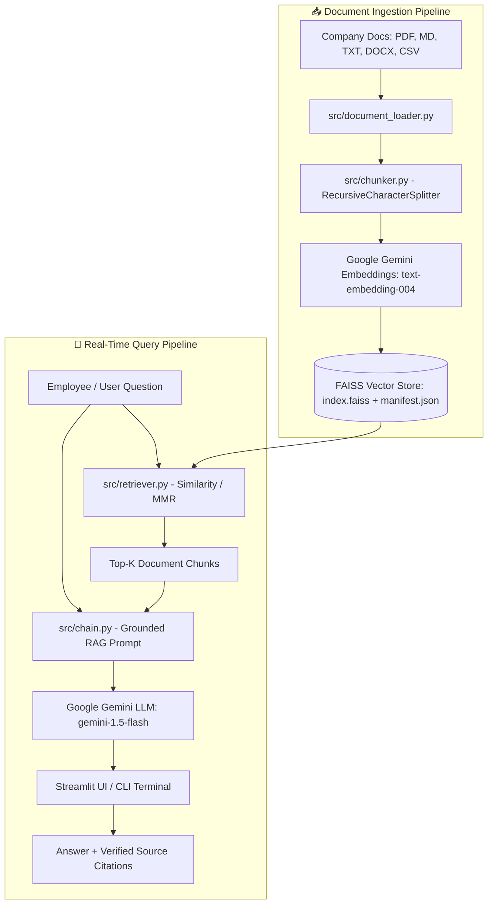

# 🏢 Company Knowledge Base RAG Chatbot — Architecture

## 1. System Overview

The **Company Knowledge Base RAG Chatbot** provides an AI assistant for enterprise employees, engineering squads, and HR operations. It answers questions strictly grounded in internal documentation (PDF, Markdown, TXT, DOCX, CSV) using **Retrieval-Augmented Generation (RAG)**.



---

## 2. Component Breakdown

| Component | Module | Responsibility |
|-----------|--------|----------------|
| **Document Loader** | `src/document_loader.py` | Parses `.pdf`, `.md`, `.txt`, `.docx`, `.csv` into unified `Document` objects with metadata (`filename`, `source`, `page`, `file_size`). |
| **Semantic Chunker** | `src/chunker.py` | Breaks continuous text into overlapping semantic passages (default `1000` chars, `200` overlap) preserving section headers. |
| **Embedding Engine** | `GoogleGenerativeAIEmbeddings` | Translates text chunks into high-density 768-dimensional vector representations via `models/text-embedding-004`. |
| **Vector Database** | `src/vectorstore.py` (`FAISS`) | Stores vector index on disk (`vectorstore/`) enabling millisecond cosine and L2 similarity search without external database servers. |
| **Retriever** | `src/retriever.py` | Configures retrieval strategies: standard **Cosine Similarity** or **MMR** (Maximal Marginal Relevance) to balance relevance with diversity. |
| **Grounded Chain** | `src/chain.py` | Formats retrieved chunks into markdown context and enforces strict anti-hallucination rules via system prompts. |
| **Streamlit Interface** | `app.py` | Enterprise chat UI with in-browser file upload, live re-indexing, parameter controls (Top-K, Temperature), and source citation expanders. |
| **CLI Query Tool** | `scripts/query.py` | Terminal interface for headless testing, cron pipelines, and developer evaluations. |

---

## 3. Data Flow & Execution Sequence

```
1. Ingest:
   Documents Folder ──► File Parsing ──► Text Chunking ──► Vector Embeddings ──► FAISS Index
                                                                                 (index.faiss)

2. Query:
   User Prompt ──► Question Embedding ──► FAISS Top-K Search ──► Context Retrieval
                                                                         │
                                                                         ▼
   Final Answer + Citations ◄── LLM Synthesis (Gemini) ◄── System Prompt + Retrieved Context
```

---

## 4. Key Security & Grounding Measures

1. **Anti-Hallucination Prompting:** The LLM is explicitly instructed to decline answering if the requested information is absent from company documents.
2. **Transparent Citations:** Every generated statement can be cross-checked against the collapsible source document cards displaying the exact excerpt and page number.
3. **Local-First Vector Storage:** Vector embeddings reside locally on disk in `vectorstore/`, keeping company intellectual property within the organization's perimeter.
