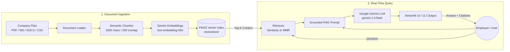

<div align="center">

# 🏢 Company Knowledge Base RAG Chatbot

**Enterprise-grade AI Assistant grounded in internal company policies, handbooks, and engineering guidelines.**

[](https://www.python.org/)
[](https://www.langchain.com/)
[](https://ai.google.dev/)
[](https://github.com/facebookresearch/faiss)
[](https://streamlit.io/)
[](https://opensource.org/licenses/MIT)

[Features](#-key-features) • [Architecture](#-system-architecture) • [Quick Start](#-quick-start) • [Web UI](#-streamlit-chat-ui) • [CLI Testing](#-cli-query-tool) • [Configuration](#%EF%B8%8F-configuration) • [Tests](#-testing)

</div>

---

## 💡 Overview

Internal company documentation is often scattered across Notion pages, PDFs, Markdown repos, and Slack threads. **Company Knowledge Base RAG** centralizes internal knowledge into a local, high-performance vector index and connects it to **Google Gemini** through **LangChain**.

Employees can ask natural language questions regarding vacation policies, engineering code standards, IT security rules, or onboarding procedures, receiving **truthful answers cited directly to the exact document and page**.

---

## ✨ Key Features

- **Multi-Format Document Ingestion:** Supports `.pdf`, `.md`, `.markdown`, `.txt`, `.docx`, and `.csv`.
- **Accurate Grounding & Citations:** Every answer cites source files, page numbers, and collapsible text excerpts.
- **Strict Anti-Hallucination Guardrails:** If information is missing from documents, the AI explicitly states it cannot find it rather than fabricating facts.
- **In-Browser Document Upload & Re-indexing:** Drag & drop new documents in the Streamlit sidebar and re-index with a single click.
- **Flexible Retrieval Strategies:** Choose between standard **Cosine Similarity** and **MMR (Maximal Marginal Relevance)** to avoid redundant chunks.
- **CLI Query Tool:** Headless command-line interface (`scripts/query.py`) for automated pipelines, cron tasks, and terminal workflows.
- **Local-First Privacy:** Vector embeddings are stored locally via FAISS (`vectorstore/`), protecting company data boundaries.

---

## 🏛️ System Architecture



---

## 🚀 Quick Start

### 1. Clone the Repository
```bash
git clone https://github.com/Farhodoff/company-knowledge-base-rag.git
cd company-knowledge-base-rag
```

### 2. Set Up Virtual Environment

Using standard Python:
```bash
python3 -m venv venv
source venv/bin/activate  # On Windows: venv\Scripts\activate
pip install -r requirements.txt
```

Or using [uv](https://github.com/astral-sh/uv) (ultra-fast):
```bash
uv venv
source .venv/bin/activate
uv pip install -r requirements.txt
```

### 3. Configure API Key
Create your `.env` file from the provided template:
```bash
cp .env.example .env
```
Open `.env` and set your [Google Gemini API Key](https://aistudio.google.com/apikey):
```ini
GOOGLE_API_KEY=your_actual_gemini_api_key
```

### 4. Ingest Documents into FAISS
Index the built-in sample documents (vacation policy, backend standards, onboarding, IT security):
```bash
python scripts/ingest.py
```

### 5. Launch the Web Interface
```bash
streamlit run app.py
```
Open `http://localhost:8501` in your browser.

---

## 💻 CLI Query Tool

Test queries directly from your terminal without opening a browser:

```bash
# Ask a specific question
python scripts/query.py "How do I request vacation days?"

# Query with custom Top-K retrieval chunks
python scripts/query.py --top-k 5 "What are our git branch naming conventions?"

# Interactive prompt mode
python scripts/query.py
```

---

## 📂 Project Structure

```
company-knowledge-base-rag/
├── app.py                      # Enterprise Streamlit Web UI
├── config.py                   # Central configuration & path resolvers
├── requirements.txt            # Python dependencies
├── .env.example                # Environment variables template
├── README.md                   # Project documentation
├── docs/
│   └── ARCHITECTURE.md         # Detailed architecture & technical specs
├── documents/                  # Knowledge base folder
│   ├── sample_vacation_policy.md
│   ├── sample_backend_standards.md
│   ├── sample_employee_onboarding.md
│   └── sample_it_security_policy.md
├── src/
│   ├── __init__.py
│   ├── document_loader.py      # Multi-format document parser
│   ├── chunker.py              # Recursive semantic text chunker
│   ├── vectorstore.py          # FAISS index persistence & manifest tracker
│   ├── retriever.py            # Similarity and MMR retrieval strategies
│   └── chain.py                # LCEL grounded RAG prompt & synthesis chain
├── scripts/
│   ├── ingest.py               # Batch document ingestion pipeline
│   └── query.py                # Headless command-line query utility
└── tests/
    ├── __init__.py
    └── test_rag.py             # Offline unit tests for chunking & loaders
```

---

## ⚙️ Configuration

All parameters can be customized via `.env` or system environment variables:

| Variable | Default | Description |
|:---|:---|:---|
| `GOOGLE_API_KEY` | — | **Required.** Google Gemini API Key from Google AI Studio |
| `EMBEDDING_MODEL` | `models/text-embedding-004` | Gemini embedding model for vectors |
| `LLM_MODEL` | `gemini-1.5-flash` | Gemini model for answer generation |
| `TEMPERATURE` | `0.2` | Generation creativity (0.0 = deterministic) |
| `CHUNK_SIZE` | `1000` | Target character count per semantic chunk |
| `CHUNK_OVERLAP` | `200` | Overlap character count between adjacent chunks |
| `TOP_K_RETRIEVAL` | `4` | Number of most relevant chunks passed to LLM |
| `SEARCH_TYPE` | `similarity` | Retrieval mode: `similarity` or `mmr` |

---

## 🧪 Testing

Run automated offline unit tests to verify document parsing, chunking logic, and formatting:

```bash
pytest tests/ -v
```

---

## 📈 Production Roadmap

- [x] Multi-format document support (PDF, MD, TXT, DOCX, CSV)
- [x] In-browser file upload & instant re-indexing in Streamlit
- [x] Headless CLI query interface
- [x] MMR (Maximal Marginal Relevance) search strategy
- [x] Automated CI testing workflow
- [ ] Hybrid search with BM25 keyword matching
- [ ] Enterprise SSO (Okta / Google OAuth) authentication
- [ ] Slack / Discord bot integration webhook

---

## 👤 Author

Developed by **[Farhod](https://github.com/Farhodoff)**

Contributions, bug reports, and suggestions are welcome! Feel free to open an issue or pull request.
